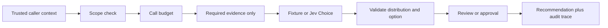

# Agent Decision Lab

**Author: Sandeep Belgavi**

100 runnable Java agent recipes for bounded review and routing tasks, with a shared guardrail runtime, synthetic fixtures, an optional Jev HTTP adapter, and an architecture article series. One clone contains every definition and example input.

**Status: educational preview.** These are 100 task-specific recipes on one runtime, not 100 independently deployed applications. Offline mode does not call an AI model. The live adapter calls TypeSafe's Jev API using your key; no paid provider call was made during initial validation. There are no business-effect tools, deployed login system, database, payment integration or production authentication in this repository.

## Quick start

Requires Java 17+ and Maven 3.9+.

```sh
git clone https://github.com/Sandeep-BA/agent-decision-lab.git
cd agent-decision-lab
mvn verify
java -jar target/agent-decision-lab.jar --list
java -jar target/agent-decision-lab.jar ticket-triage
java -jar target/agent-decision-lab.jar prompt-injection-reviewer --approve-recommendation
```

The default fixture returns fixed probabilities so that you can inspect the pipeline. It is not a classifier and does not judge your input. A successful offline run ends at `RECOMMENDATION_READY` only when the recommendation approval flag is present; it never executes a real effect.

## Choose a recipe

[Browse all 100 recipes](CATALOG.md), grouped into Support, Security, Cloud, Data, Development, Research, Product, Operations, Learning and Agent systems. Each defines its own task, evidence fields, scope and choice rubric. Editable source: [recipes.tsv](recipes.tsv). Generated runtime definitions: [agents.json](src/main/resources/agents.json). [Example JSON inputs](examples/) use synthetic placeholders, not real records.

Change a definition in `recipes.tsv`, then run `python scripts/build_recipes.py` and `mvn verify`. Do not edit generated JSON independently of its source. The fixed example threshold 0.85 is a teaching value; it has not been calibrated for any real workload.

## Try a real Jev decision

Review the [current TypeSafe API](https://docs.typesafe.ai/api), account access, data-handling terms and cost before sending your data. Set `TYPESAFE_API_KEY` through your environment or secret manager, never a committed file. Set `TYPESAFE_MODEL` to the version you evaluated; the example defaults to `jev-1.13.0` for reproducibility rather than a moving alias.

Replace the synthetic fields in a copy of `examples/ticket-triage.json` with authorized, minimized test evidence, then:

```sh
java -jar target/agent-decision-lab.jar ticket-triage --live --state /path/to/reviewed-input.json
```

This command makes **one paid API request** to `https://api.typesafe.ai/v1/systemone`. It sends only the recipe's required evidence fields. Credentials stay in an HTTP header. Redirects are disabled, request/response bodies are capped at 64 KiB, the request timeout is 15 seconds, and there are no automatic retries. The CLI returns status and trace metadata, not original evidence or raw provider errors. Selected options and model IDs are still output metadata: treat them according to your data policy.

The Java adapter implements Choice questions only. The articles also explain Noul, Score and Box; those additional primitives are **not** silently implemented by this adapter. This is not an official TypeSafe SDK. No Jev architecture, weights or training code are bundled.

## Pipeline and trust boundary



The CLI supplies its own scope and one-call budget as a demonstration. In a service, those must come from authenticated server-side context, durable quotas and an approval store. Do not accept them from an untrusted browser. The in-memory trace is not a durable audit trail. No action executor exists, so approval authorizes producing a recommendation, not a refund, deployment or account change.

The validator rejects unknown choices, mismatched option sets, non-finite/out-of-range probabilities, distributions that do not sum to one and a selected option that is not a maximum. This catches malformed output; it cannot prove a semantic judgment is correct. Type-safe mistakes remain possible.

## Validation and limitations

`mvn verify` runs ten scenarios for every recipe: valid recommendation, wrong scope, exhausted budget, missing evidence, missing approval, review, block, invalid output, provider outage, and low confidence. Provider-contract tests verify HTTP payload construction and response parsing against fixtures. These tests establish code behavior, not task accuracy, calibration, fairness, prompt-injection resistance or production availability.

Live Jev calls, ADK integration, Ollama inference and business connectors are not validated here. You can implement another `Engine.Model` adapter, but label it separately and add paired evaluations before substituting a model. The [article series](articles/) discusses those design choices without claiming that conceptual deployment diagrams are deployed infrastructure.

## Related work

- [Cassandra MCP: Node, Python, Java, catalog and skills](https://github.com/Sandeep-BA/cassandra-mcp)
- [AICassindra](https://aicassindra.com/) — website publication may lag repository releases.
- [TypeSafe documentation](https://docs.typesafe.ai/) — authoritative provider contract.

MIT licensed. Independent project; not affiliated with TypeSafe AI, Google or Apache.
